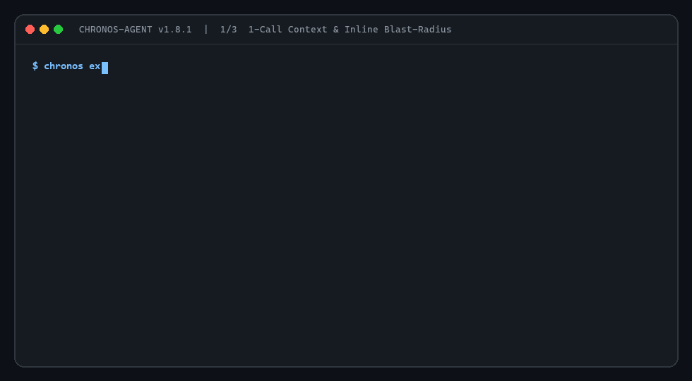

<p align="center">
  
</p>

<h1 align="center">CHRONOS-AGENT</h1>

<p align="center">
  <strong>Single-binary Rust MCP server (Tree-sitter + KuzuDB + Sandboxed Rhai) for fresh-parse AST symbol editing, edge-verified multi-file refactoring, and blast-radius gating. No LSP daemon required.</strong>
</p>

<p align="center">
  <a href="https://github.com/ptai-eng/chronos-agent/releases/tag/v1.8.0"></a>
  <a href="https://www.npmjs.com/package/@ptai-eng/chronos-mcp"></a>
  <a href="https://registry.modelcontextprotocol.io/v0.1/servers?search=io.github.ptai-eng/chronos-agent"></a>
  <a href="https://marketplace.visualstudio.com/items?itemName=ptai-eng.chronos-agent"></a>
  <a href="https://www.rust-lang.org"></a>
  <a href="./chronos-core/tests"></a>
  <a href="https://spec.modelcontextprotocol.io"></a>
  <a href="./SECURITY.md"></a>
  <a href="https://glama.ai/mcp/servers/ptai-eng/chronos-agent"></a>
</p>

<p align="center">
  
</p>

## 30-Second Quickstart

**Zero-install via `npx` (requires Node.js 18+; auto-fetches your OS release binary):**
```bash
npx -y @ptai-eng/chronos-mcp --workspace .
```

**Or install prebuilt binaries (`chronos` CLI + `chronos-mcp` server) without Node.js, C++, or Rust:**

**Windows (PowerShell):**
```powershell
irm https://raw.githubusercontent.com/ptai-eng/chronos-agent/main/scripts/install.ps1 | iex
```

**macOS (Apple Silicon) & Linux (x64):**
```bash
curl -fsSL https://raw.githubusercontent.com/ptai-eng/chronos-agent/main/scripts/install.sh | sh
```

*(Other options: [`cargo-binstall`](https://github.com/cargo-bins/cargo-binstall) via `cargo binstall --git https://github.com/ptai-eng/chronos-agent chronos-cli chronos-mcp`, or OCI container `docker run -i --rm -v "${PWD}:/workspace" ghcr.io/ptai-eng/chronos-agent:1.8.0` via the [Official MCP Registry](https://registry.modelcontextprotocol.io/v0.1/servers?search=io.github.ptai-eng/chronos-agent).)*

Bootstrap configs for Codex, Antigravity, Claude Code, Cursor, OpenCode, Windsurf, Copilot, and Cline in any workspace:

```bash
cd your-project
chronos init --client all --with-hooks
```

Or drop `@ptai-eng/chronos-mcp` (or `chronos-mcp`) directly into any MCP client config:

```json
{
  "mcpServers": {
    "chronos-agent": {
      "command": "npx",
      "args": ["-y", "@ptai-eng/chronos-mcp", "--workspace", "."]
    }
  }
}
```

<p align="center">
  <a href="https://glama.ai/mcp/servers/ptai-eng/chronos-agent">
    
  </a>
</p>

---

## Table of Contents

- [Why CHRONOS vs. Serena & Built-in Grep](#why-chronos-vs-serena--built-in-grep)
- [What's New in v1.8.0](#whats-new-in-v180)
- [Core Architecture](#core-architecture)
- [Capability Matrix](#capability-matrix)
- [14 Canonical MCP Tools](#14-canonical-mcp-tools)
- [VS Code Extension](#vs-code-extension)
- [CLI Command Suite & Build from Source](#cli-command-suite--build-from-source)
- [Security & Local-First Guarantees](#security--local-first-guarantees)

---

## Why CHRONOS vs. Serena & Built-in Grep

Coding agents normally inspect repositories with sequential `grep` + line-range reads and apply raw string diffs without knowing who calls a function or whether `foo` also appears as an unrelated local variable.

| Aspect | Built-in Agent Grep / Line Edits | Daemon LSP MCPs (e.g. Serena) | **CHRONOS-AGENT v1.8** |
| :--- | :--- | :--- | :--- |
| **Runtime Model** | Text regex per turn | Background language server daemon per language | **Single Rust binary (`<15ms` queries, zero daemon)** |
| **Symbol Editing Safety** | Trusts stale line numbers / diff hunks | LSP offsets + text rewrite | **Fresh Tree-sitter re-parse on every write + 2-Stage Gate** (`syntax_error` & `blocked_requires_force` when signature changes on callers) |
| **Multi-File Rename** | Global text search/replace risks corrupting locals & comments | Compiler/LSP reference list | **AST identifier classification** separating `verified_edits` (`CALLS`/`TESTS`/imports) from `candidate_sites` (`obj.method()`, shadowed locals) + atomic rollback |
| **Impact & Test Awareness** | None | Caller references when server is warm | **KuzuDB graph + Git co-change coupling + Reverse-BFS entrypoints (`verification_surfaces`) + Mutation testing** |
| **Current Trade-off (`v1.8.0`)** | Zero semantic guarantees | Full compiler type resolution when LSP compiles cleanly | **Pure static Tree-sitter (`v1.8.0`):** dynamic `obj.method()` receivers go to `candidate_sites` for review instead of guessing; opt-in Hybrid LSP lands in [`v1.8.1`](./docs/ROADMAP-v1.8-SERENA-EXPANSION.md) |

---

## What's New in v1.8.0

`v1.8.0` turns `CHRONOS-AGENT` into a gated **read + edit + refactor + script** workspace engine across 7 language families (`.ts`/`.tsx`/`.js`/`.jsx`, `.py`, `.rs`, `.go`, `.c`/`.cpp`, `.java`):

| Subsystem | v1.8.0 Upgrade |
| :--- | :--- |
| **1. Fresh-Parse AST Editing (`chronos_edit_symbol` #13 & `chronos edit`)** | Reads current bytes from disk and parses a fresh Tree-sitter CST before every edit (`declaration_span` vs. `full_symbol_span`). Deduplicates `#[attributes]`, `@decorators`, and doc-comments, matches target column indentation, preserves UTF-8 BOM & `CRLF`/`LF` via `AtomicFileWriter`, and enforces a **2-Stage Gate** (Stage 1 syntax gate + Stage 2 signature contract & `fan_in > 0` check). |
| **2. Edge-Verified Refactoring (`chronos_refactor_symbol` #14, `chronos rename`, `chronos delete`)** | Classifies AST identifiers while skipping comments and string literals, protects module-path prefixes (`use crate::math::math;`), blocks `blocked_ambiguous_rename` on candidates/homonyms/unresolved calls without `--force`, validates syntax on 100% of touched files before transactional rollback-safe commit, and hardens `safe_delete` against callers, tests, `ApiRoute`s, entrypoints, `pub`/export coverage gaps, and Rust trait impls. |
| **3. Progressive `Class/*` & Batch `chronos_explore` (#12)** | Supports `Class/*` wildcard outlines (with per-`impl` `NodeId` isolation in Rust), `include_body: false` signature outlines, `depth` child expansion, batch `queries[]`, and inline `include_blast_radius`. |
| **4. Sandboxed `rhai` 5D Script Engine (`chronos_explore.script`, `chronos eval`, `chronos repl`)** | Embeds `rhai` (`Engine::new_raw()`, bounded at `50_000` ops, zero disk/network/shell I/O) with strict dual profiles: `ScriptProfile::ReadOnly` for MCP & `--readonly` CLI, and `ScriptProfile::FullCli` for gated CLI scripts and interactive REPL sessions. |
| **5. `AtomicFileWriter` & `xxHash64` Deduplication** | Transactional multi-file writes roll back all prior modified files on disk error; `WorkspaceSession::index_file` caches `last_indexed_hashes` to skip redundant `FileWatcher` bursts in `<0.2ms`. |

<details>
<summary><strong>Previous Releases (v1.7.0, v1.6.0, v1.5.0, v1.4.0, v1.3.0 &amp; v1.2.0)</strong></summary>

- **v1.7.0:** Consolidated `WorkspaceSession`, canonical `ToolRegistry` / `McpToolRegistry` (zero schema drift), Schema v2 `GraphRepository`, `_meta.contract_alerts` middleware, 24k `max_answer_chars` UTF-8 budgeting, and upgraded embedded KuzuDB to single-file `0.11.3` (`cxx-build = 1.0.138`) fixing Linux GCC 15 CI aborts.
- **v1.6.0:** Added `chronos_explore`, Reverse-BFS `verification_surfaces`, line-anchored `structured_findings`, 4-Angle Review Audit (`Reuse`, `Efficiency`, `Simplification`, `Altitude`), `<20ms` lifecycle hooks (`chronos hook`), and the 20-file multi-agent scaffolder.
- **v1.5.0:** Added `chronos init`, `chronos agents-md`, `chronos schema` exporter (OpenAI, Anthropic, Gemini, Codex TOML, MCP), and `SECURITY.md`.
- **v1.4.0:** Added KuzuDB `xxHash64` incremental sync, cross-boundary HTTP route stitching (`/{*}`), Git `CO_CHANGES_WITH` co-change mining, single-compile `CHRONOS_MUTANT_ID` Super-Mutant evaluation, and offline telemetry hydration (`.cpuprofile`, Speedscope, Folded Flamegraph, OTLP JSON).
- **v1.3.0 & v1.2.0:** Polyglot 7-language Tree-sitter parser, interprocedural `transitive_loop_depth` / $O(N^2)$ loop scan detection, read-only OpenCypher (`chronos_query_graph`), BM25 search, Label Propagation clustering, PageRank `confidence_interval`, and `chronos diff --ci`.

</details>

---

## Core Architecture

<p align="center">
  
</p>

| Component | Responsibility | Crate Path |
| :--- | :--- | :--- |
| **Knowledge Graph &amp; Query** | `Petgraph` call/test topology, embedded single-file `KuzuDB 0.11.3`, OpenCypher, BM25 + `Class/*` exploration, Git co-change mining | `chronos-core/src/graph/` |
| **Fresh AST Editor &amp; Refactor** | Tree-sitter 7-language parsers, `FreshParsedFile` trivia spans, `AtomicFileWriter`, `chronos_edit_symbol`, `chronos_refactor_symbol` | `chronos-core/src/ast/` |
| **Sandboxed Rhai Script Engine** | `Engine::new_raw()` with `50_000` ops ceiling separating `ScriptProfile::ReadOnly` (MCP) from `ScriptProfile::FullCli` | `chronos-core/src/script/` |
| **Contract Broker &amp; Blast Radius** | 300ms debounced watcher, signature fingerprinting, PageRank impact scoring, confidence intervals, 4-angle audit, surface tracer | `chronos-core/src/{contract,blast_radius}/` |
| **Super-Mutant &amp; Telemetry** | Graph-selected sandbox mutation runner (`CHRONOS_MUTANT_ID`), CDP V8 / eBPF adapters, offline `.cpuprofile`/OTLP hydrator | `chronos-core/src/{mutation,telemetry}/` |

---

## Capability Matrix

<p align="center">
  
</p>

---

## 14 Canonical MCP Tools

`chronos-mcp` speaks **MCP (v2024-11-05)** over stdio JSON-RPC 2.0, exposes **14 canonical tools** (plus compatibility aliases `chronos_replace_symbol_body`, `chronos_rename_symbol`, `chronos_safe_delete`), enforces `--readonly` guards, injects `_meta.contract_alerts`, and caps oversized replies cleanly via `max_answer_chars`:

| # | Tool Name | Mode | Category | Description |
| :---: | :--- | :---: | :--- | :--- |
| 1 | `chronos_analyze_file` | Read | Ingestion &amp; Audit | Parse source file (7 language families), sync KuzuDB delta, and run 4-Angle Review Audit. |
| 2 | `chronos_query_hotspots` | Read | Telemetry | Rank runtime bottlenecks, PageRank hubs, and nested loop hotspots. |
| 3 | `chronos_blast_radius` | Read | Impact &amp; Findings | Compute PageRank blast-radius, `verification_surfaces`, `structured_findings`, Git co-changes, and uncertainty intervals. |
| 4 | `chronos_mutation_gate` | Read | Verification | Execute graph-selected covering tests against Super-Mutant builds. |
| 5 | `chronos_contract_status` | Read | Contracts | Drain queued Semantic Contract Broker alerts from the Pre-Tool Execution Gate. |
| 6 | `chronos_query_graph` | Read | Cypher | Run read-only OpenCypher queries over KuzuDB (`CALLS`, `CONTAINS`, `TESTS`, `IMPORTS`, `CO_CHANGES_WITH`). |
| 7 | `chronos_search_graph` | Read | Discovery | Search symbols with BM25 identifier tokenization (`camelCase`/`snake_case`), regex, degree, and loop filters. |
| 8 | `chronos_get_snippet` | Read | Context | Read verbatim `start_line..=end_line` code with callers, callees, covering tests, and AST metrics. |
| 9 | `chronos_get_architecture` | Read | Topology | Index workspace incrementally, mine Git co-changes, and extract Label Propagation clusters + hotspots. |
| 10 | `chronos_hydrate_telemetry` | Read | Telemetry | Hydrate runtime metrics from `.cpuprofile`, Speedscope/`py-spy`, Folded Flamegraph, or OTLP JSON. |
| 11 | `chronos_generate_agents_md` | Read/Preview | Multi-Agent | Synthesize [`AGENTS.md`](./AGENTS.md), [`CLAUDE.md`](./CLAUDE.md), [`GEMINI.md`](./GEMINI.md), Antigravity `SKILL.md`, Cursor `.mdc`, and hooks (`write_to_disk: true` blocked under `--readonly`). |
| 12 | `chronos_explore` | Read | **1-Call Context** | 1-call context engine supporting `Class/*` wildcards, `include_body: false`, `depth`, batch `queries[]`, inline `include_blast_radius`, and `ScriptProfile::ReadOnly` Rhai `script`. |
| 13 | `chronos_edit_symbol` | **Write** | **AST Editing** | Fresh-parse `replace_body`, `insert_before`, `insert_after` with trivia dedup, BOM/CRLF preservation, and 2-Stage gate (alias `chronos_replace_symbol_body`; disabled in `--readonly`). |
| 14 | `chronos_refactor_symbol` | **Write / Preview** | **Refactoring** | Edge-verified `rename`, hardened `safe_delete`, and `preview_usages` (`verified_edits` vs. `candidate_sites`) with multi-file atomic rollback (aliases `chronos_rename_symbol`, `chronos_safe_delete`; `--readonly` permits `preview_usages` and `dry_run: true`). |

### Supported AI Clients (`chronos init --client all --with-hooks`)

| Client / IDE | Generated Files |
| :--- | :--- |
| **OpenAI Codex CLI** | [`AGENTS.md`](./AGENTS.md), [`.codex/config.toml`](./.codex/config.toml) |
| **Google Antigravity (`agy`)** | [`GEMINI.md`](./GEMINI.md), [`.agents/skills/chronos-agent/SKILL.md`](./.agents/skills/chronos-agent/SKILL.md), [`.agents/plugins/chronos-agent/`](./.agents/plugins/chronos-agent/plugin.json), [`.agents/hooks.json`](./.agents/hooks.json) |
| **Anthropic Claude Code** | [`CLAUDE.md`](./CLAUDE.md), [`.mcp.json`](./.mcp.json), [`.claude/commands/chronos-audit.md`](./.claude/commands/chronos-audit.md), [`.claude/settings.json`](./.claude/settings.json) |
| **OpenCode, Cursor, Windsurf, Copilot, Cline** | [`opencode.json`](./opencode.json), [`.opencode/agent/chronos-auditor.md`](./.opencode/agent/chronos-auditor.md), [`.cursor/rules/chronos-5d.mdc`](./.cursor/rules/chronos-5d.mdc), [`.cursor/mcp.json`](./.cursor/mcp.json), [`.windsurfrules`](./.windsurfrules), [`.windsurf/mcp.json`](./.windsurf/mcp.json), [`.github/copilot-instructions.md`](./.github/copilot-instructions.md), [`.vscode/mcp.json`](./.vscode/mcp.json), [`.clinerules`](./.clinerules) |

Export AI SDK schemas directly for custom agent harnesses:

```bash
chronos schema --format responses > openai.json  # OpenAI Responses API (14 tools, strict: true)
chronos schema --format anthropic > claude.json  # Anthropic Messages API (14 tools, input_schema)
chronos schema --format gemini > gemini.json     # Google Gemini / Vertex AI (14 tools, functionDeclarations)
```

---

## VS Code Extension

<p align="center">
  
</p>

Install **"CHRONOS Agent"** from the [Visual Studio Marketplace](https://marketplace.visualstudio.com/items?itemName=ptai-eng.chronos-agent) (`chronos-vscode/`):
- **Incremental Watcher:** Re-indexes modified source files on save across all 7 language families and syncs `KuzuDB`.
- **Blast-Radius &amp; Uncertainty HUD:** Surfaces composite impact scores, confidence intervals, PageRank hubs, Git co-change partners, and surviving mutants inside VS Code.

---

## CLI Command Suite & Build from Source

### Common CLI Commands

```powershell
# 1. Surgical AST Symbol Edit (with 2-stage syntax & blast-radius gate)
chronos edit charge --file src/billing.rs --op replace_body --code "pub fn charge(a: i32) -> i32 { a * 2 }" --dry-run

# 2. Edge-Verified Multi-File Rename & Hardened Safe Delete
chronos rename compute_tax calculate_vat --file src/billing.rs --dry-run
chronos delete legacy_helper --file src/cleanup.rs

# 3. Embedded Rhai 5D Scripting (One-Shot Eval & Interactive REPL)
chronos eval "hotspots(5)" --readonly --json
chronos repl

# 4. 1-Call Context Explore (Wildcards, Signature Outline & Blast-Radius)
chronos explore "OrderService/*" --no-body --depth 2 --blast-radius

# 5. Full Audit, Architecture, Search, Cypher & Git Diff Gate
chronos audit src/services/orderService.ts
chronos hydrate profile.cpuprofile --json
chronos arch chronos-core/src
chronos query "MATCH (n:ChronosNode) WHERE n.transitive_loop_depth >= 2 RETURN n.name, n.transitive_loop_depth LIMIT 10"
chronos diff --staged --json --ci
```

### Build from Source

```bash
# Prerequisites: Rust 1.85+, CMake, C++ compiler (for embedded KuzuDB 0.11.3)
git clone https://github.com/ptai-eng/chronos-agent.git
cd chronos-agent
cargo build --release -j 4
cargo test --workspace -j 4
```

---

## Security & Local-First Guarantees

`CHRONOS-AGENT` runs locally inside your workspace with no outbound telemetry or cloud code uploads:

- **Workspace Path Jailing:** Every read, index, edit, and refactor call canonicalizes paths via `WorkspaceSession::validate_workspace_path` and rejects paths escaping `workspace_root`.
- **Strict `--readonly` Mode:** Passing `--readonly` to `chronos-mcp` hides mutating tools (`chronos_edit_symbol`, `chronos_refactor_symbol`) from `tools/list` and blocks disk writes while preserving read-only previews (`preview_usages`, `dry_run`).
- **Isolated Rhai Sandbox:** `ScriptEngine` initializes `Engine::new_raw()` with zero filesystem, network, process, or env APIs and aborts runaway scripts at `50_000` operations. MCP `chronos_explore.script` runs under `ScriptProfile::ReadOnly`, which never registers write bindings.
- **Transactional Integrity & Read-Only Cypher:** Disk writes use `AtomicFileWriter` (BOM/CRLF preservation + multi-file rollback), OpenCypher queries pass `validate_readonly_cypher`, and extracted snippets carry `_meta.provenance.untrusted_content`.
- **Opt-In Profiling & Sandbox Testing:** Linux eBPF tracepoints, Chrome DevTools WebSocket attachment, and isolated test subprocesses only run when explicitly invoked via profiling or mutation commands. Full threat model details live in [`SECURITY.md`](./SECURITY.md).

---

## License

Distributed under the **MIT License**. See [LICENSE](./LICENSE) for details.
