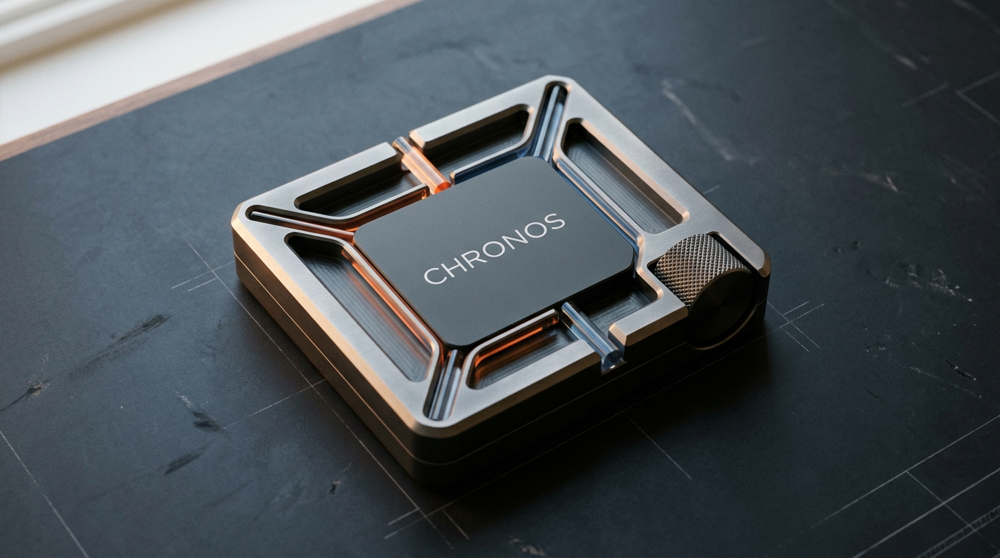
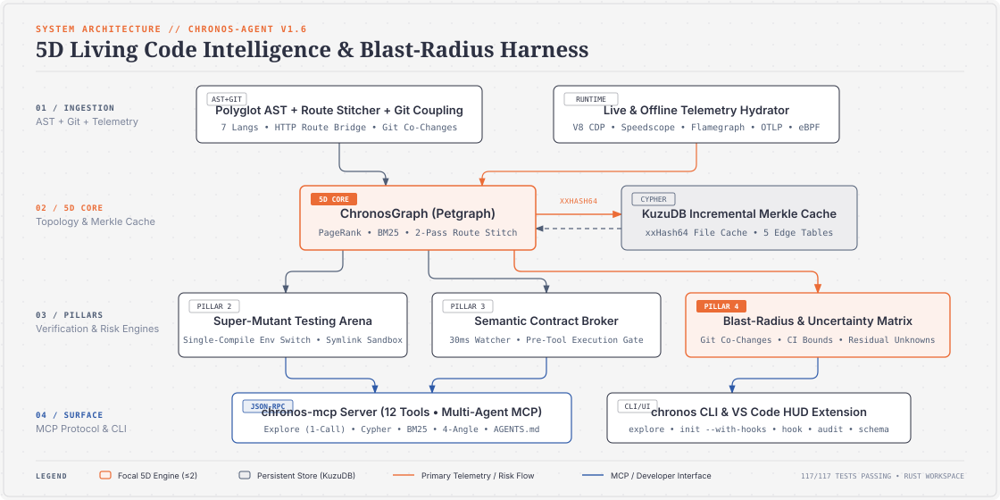
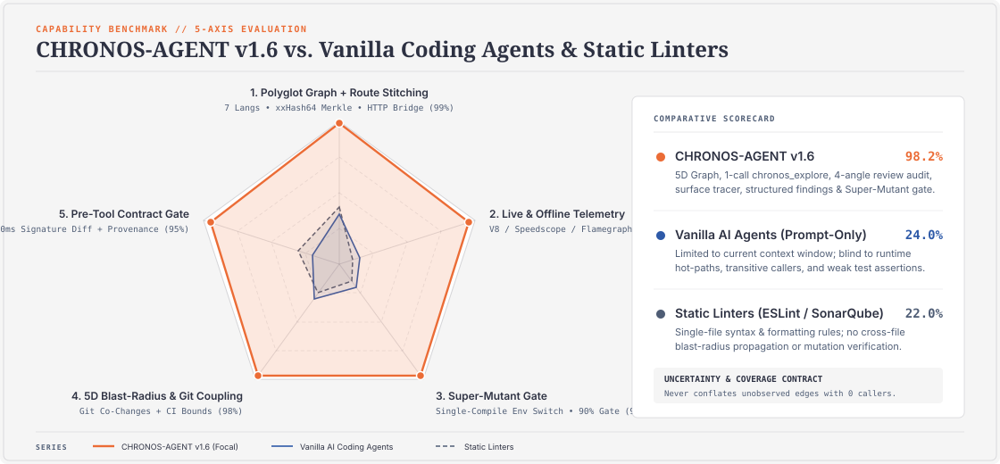
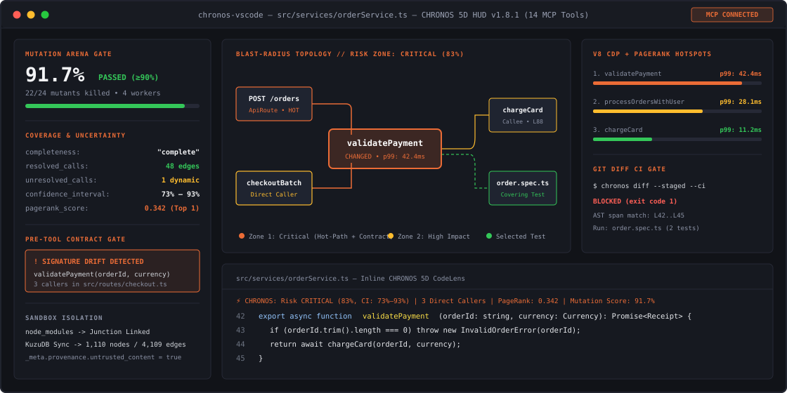

<p align="center">
  
</p>

<h1 align="center">CHRONOS-AGENT</h1>

<p align="center">
  <strong>5D Living Code Graph, 1-Call Subagent Context (<code>chronos_explore</code>), 4-Angle Code Review Audit, Surface Entrypoint Tracer, Universal Multi-Agent Synthesizer (20 Native Files) &amp; Super-Mutant Gating</strong>
</p>

<p align="center">
  <a href="https://github.com/ptai-eng/chronos-agent/releases/tag/v1.6.0"></a>
  <a href="https://marketplace.visualstudio.com/items?itemName=ptai-eng.chronos-agent"></a>
  <a href="https://www.rust-lang.org"></a>
  <a href="./chronos-core/tests"></a>
  <a href="https://spec.modelcontextprotocol.io"></a>
  <a href="./AGENTS.md"></a>
  <a href="./SECURITY.md"></a>
</p>

---

## Table of Contents

- [What's New in v1.6.0](#whats-new-in-v160)
- [Why CHRONOS Exists](#why-chronos-exists)
- [Core Architecture: The 4 Pillars](#core-architecture-the-4-pillars)
- [Capability Matrix &amp; Benchmark](#capability-matrix--benchmark)
- [Developer HUD &amp; VS Code Extension](#developer-hud--vs-code-extension)
- [Universal AI Integrations (Codex, Antigravity, Claude Code, OpenCode &amp; 12 MCP Tools)](#universal-ai-integrations-codex-antigravity-claude-code-opencode--12-mcp-tools)
- [Quickstart &amp; Installation](#quickstart--installation)
- [CLI Command Suite](#cli-command-suite)
- [Security &amp; Privacy Notice (NVIDIA SkillSpector Alert)](#security--privacy-notice-nvidia-skillspector-alert)

---

## What's New in v1.6.0

`v1.6.0` (**The 1-Call Subagent Context, 4-Angle Review Audit &amp; Universal Lifecycle Hooks Edition**) distills the highest-leverage agentic engineering workflows from **Anthropic Claude Code** (`Explore`, `verify`, `code-review`, `ReportFindings`), **OpenAI Codex** (`codex-auto-review`), and **Google Antigravity (`agy`)** (`hooks.json` `injectSteps`, `SKILL.md`, native plugins) directly into the Rust 5D Knowledge Graph engine:

| Subsystem | v1.6.0 Upgrade |
| :--- | :--- |
| **1. 1-Call Subagent Context Engine (`chronos_explore` &amp; `chronos explore`)** | Adds the **12th MCP tool (`chronos_explore`)** and CLI subcommand (`chronos explore "<query>"`). In a single `<15ms` call, returns the top BM25/regex matching symbols, their verbatim line-numbered source snippets (`start_line..=end_line`), inbound/outbound call chains, covering tests, user-facing `verification_surfaces`, and `four_angle_diagnostics`—eliminating 5–8 sequential grep/read tool turns. |
| **2. Reverse-BFS Surface Entrypoint Tracer (`verification_surfaces`)** | Inspired by Claude Code `verify/SKILL.md` (*"Whatever calls `foo` ends at a CLI, a socket, or a window. Go there."*). Automatically traces backwards along `CALLS` and `TESTS` edges from any modified function to discover real user-facing entrypoints (`ApiRoute`, `CliCommand`, `RootEntrypoint`, `TestCase`) with exact hop distances and end-to-end verification instructions. |
| **3. Structured `ReportFindings` &amp; `failure_scenario` (`structured_findings`)** | Inspired by Claude Code `report-findings-tool.md` and OpenAI Codex `codex-auto-review.md`. Every `BlastRadiusReport` (`chronos_blast_radius` &amp; `chronos diff`) now emits line-anchored `structured_findings` (`file`, 1-indexed `line`, `short_summary` $\le 60$ chars, concrete `failure_scenario`, `category`: `"correctness" \| "efficiency" \| "simplification" \| "test-coverage"`, and `verdict`: `"CONFIRMED" \| "PLAUSIBLE"`). |
| **4. 4-Angle Code Review Audit (`Reuse`, `Efficiency`, `Simplification`, `Altitude`)** | Inspired by Claude Code `code-review/SKILL.md`. Automatically audits symbols across 4 orthogonal lenses: **`Reuse`** (cross-file duplicate/parallel logic detection via Jaccard identifier token similarity), **`Efficiency`** (`linear_scan_in_loop` / `alloc_in_loop` / hot paths), **`Simplification`** (cyclomatic &amp; loop nesting complexity), and **`Altitude`** (shared hub centrality vs. single-caller orchestrator fix level). Surfaced in `chronos_analyze_file` and `chronos_explore`. |
| **5. Zero-Latency Lifecycle Hooks (`<20ms`) &amp; 20-File Universal Scaffolder (`chronos init --with-hooks`)** | Adds `chronos hook <session-start\|post-edit> --client <antigravity\|claude\|codex>` (`<20ms`, fail-open `exit 0`) and `--with-hooks` on `chronos init --client all`, generating **20 native multi-agent integration files** including [`.agents/hooks.json`](./.agents/hooks.json) (**Google Antigravity `injectSteps`**) and [`.claude/settings.json`](./.claude/settings.json) (**Claude Code `permissions.allow` + `hooks`**)—verified **0/100 LOW (SAFE)** by NVIDIA SkillSpector. |

<details>
<summary><strong>Previous Release Highlights (v1.5.0, v1.4.0, v1.3.0 &amp; v1.2.0)</strong></summary>

- **v1.5.0 — Universal Multi-Agent Synthesizer, AI SDK Schema Exporter &amp; Codex CI Gate:** Added `chronos init --client <all|codex|antigravity|claude|opencode|cursor|windsurf|copilot|cline>`, `chronos agents-md`, `chronos schema --format <openai|responses|anthropic|gemini|codex-toml|mcp>`, `.github/workflows/codex-blast-radius.yml`, and 4-layer `SECURITY.md`.
- **v1.4.0 — 5D Graph, Incremental Merkle Cache, Route Stitching, Super-Mutant &amp; Offline Hydrator:** Added `ChronosFileHash` `xxHash64` incremental sync in KuzuDB, 2-pass Frontend $\leftrightarrow$ Backend HTTP route stitching (`/{*}`), Git Temporal Co-Change Coupling (`CO_CHANGES_WITH`), `CHRONOS_MUTANT_ID` single-compile Super-Mutant engine, and offline telemetry hydration (`chronos hydrate` / `chronos_hydrate_telemetry`) for V8 `.cpuprofile`, Speedscope, Folded Flamegraphs, and OTLP traces.
- **v1.3.0 — Polyglot 7-Language AST &amp; Cypher Engine:** Expanded Tree-sitter dispatcher to TypeScript/JS, Python, Rust, Go, C, C++, and Java; added interprocedural `transitive_loop_depth` and `linear_scan_in_loop` $O(N^2)$ detection; added read-only OpenCypher (`chronos_query_graph`), BM25 identifier search (`chronos_search_graph`), verbatim code snippets (`chronos_get_snippet`), and Label Propagation community clustering (`chronos_get_architecture`).
- **v1.2.0 — KuzuDB Edge Persistence &amp; PageRank Uncertainty:** Full KuzuDB persistence across restarts, 20-iteration damped PageRank ($\alpha = 0.85$) with explicit `confidence_interval` and `residual_unknowns`, `chronos diff --ci` AST span risk gate, and zero-copy `node_modules`/`.venv` symlink sandboxes.

</details>

---

## Why CHRONOS Exists

AI coding agents read source files as flat text buffers. When an agent edits a utility function in `Module A`, it cannot see whether that function sits on a high-PageRank call path, is called across language boundaries by a frontend `fetch()` client, co-evolves with a database schema file in Git history, triggers a transitive $O(N^2)$ nested loop, or runs inside a hot CPU loop in production.

**CHRONOS-AGENT** gives autonomous coding agents a unified 5D structural, evolutionary, and runtime verification harness:

1. **Polyglot Structural Topology + Cross-Boundary Stitching + Cypher:** Builds a 7-language AST graph (`Petgraph` in-memory + incremental `xxHash64` `KuzuDB` on disk) that stitches Frontend $\leftrightarrow$ Backend HTTP routes and is queryable via OpenCypher, BM25 identifier search, and Label Propagation community clustering.
2. **5th-Dimension Git Temporal Co-Change Coupling:** Discovers hidden evolutionary coupling ($P(B \mid A) \ge 40\%$) from Git commit history even when zero static AST imports exist.
3. **Live &amp; Offline Runtime Telemetry Overlay:** Maps live CDP V8 / Linux eBPF probes or offline `.cpuprofile`, Speedscope, Folded Flamegraph, and OTLP traces directly onto AST function nodes.
4. **Super-Mutant &amp; Graph-Guided Mutation Arena:** Queries `TESTS` edges to execute only covering tests and uses `CHRONOS_MUTANT_ID` env-switching for single-compile parallel evaluation.
5. **Explicit Epistemic Contracts:** Every blast-radius report discloses its observation coverage (`complete` vs. `partial`), uncertainty interval (`confidence_interval`), and unresolved dynamic call sites (`residual_unknowns`)—never conflating unobserved edges with zero risk.

---

## Core Architecture: The 4 Pillars

<p align="center">
  
</p>

| Pillar | Responsibility | Implementation | Crate Path |
| :--- | :--- | :--- | :--- |
| **1. 5D Knowledge Graph &amp; Cypher** | 7-language AST topology, cross-boundary HTTP route stitching, Git temporal co-changes, incremental `xxHash64` Merkle cache, OpenCypher query engine, BM25 search, 1-call `chronos_explore`, and telemetry hydration | Tree-sitter (`TS`/`JS`/`Py`/`Rs`/`Go`/`C`/`C++`/`Java`) &bull; `Petgraph` (`<15ms` traversal) &bull; Embedded `KuzuDB` (`CALLS`, `CONTAINS`, `TESTS`, `IMPORTS`, `CO_CHANGES_WITH`) | `chronos-core/src/graph/` |
| **2. Super-Mutant Arena** | Semantic test verification before code acceptance | 5 deterministic operators &bull; `CHRONOS_MUTANT_ID` single-compile Super-Mutant engine &bull; Parallel temp-dir sandboxes with zero-copy `node_modules`/`.venv` junctions | `chronos-core/src/mutation/` |
| **3. Semantic Contract Broker** | Real-time public signature lock across concurrent agents | 300ms debounced `notify` file watcher &bull; Signature fingerprinting &bull; Breaking-change interception before commit | `chronos-core/src/contract/` |
| **4. Blast-Radius &amp; Review Engine** | Risk scoring with uncertainty bounds, surface entrypoint tracer, 4-angle audit &amp; structured findings | 4-tier classification (`SAFE` / `MEDIUM` / `HIGH` / `CRITICAL`) &bull; `verification_surfaces` &bull; `structured_findings` (`failure_scenario`) &bull; `CoverageReport` &amp; `confidence_interval` | `chronos-core/src/blast_radius/` |

---

## Capability Matrix &amp; Benchmark

<p align="center">
  
</p>

### Comparison Across Tool Classes

| Capability | Static Linters (`ESLint`, `SonarQube`) | Vanilla Coding Agents (`Copilot`, `Cursor` alone) | Static Graph MCPs (`GitNexus`, `codebase-memory`) | **CHRONOS-AGENT v1.6** |
| :--- | :---: | :---: | :---: | :---: |
| **1-Call Subagent Context (`chronos_explore`)** | No | 5–8 grep/read calls | Snippet or search separately | **BM25 + Verbatim Source + Surfaces + 4-Angle Audit in 1 Call** |
| **Polyglot Call &amp; Test Graph** | Single-file rules | Token window only | Static AST edges | **7 Languages + Incremental `xxHash64` Merkle Cache** |
| **Cross-Language HTTP Route Stitching** | No | No | File-local only | **2-Pass Normalized Route Bridge (`/{*}`)** |
| **Git Temporal Co-Change Coupling** | No | No | No | **`CO_CHANGES_WITH` Conditional Probability ($P(B\mid A)$)** |
| **4-Angle Review Audit &amp; Structured Findings** | Syntax/lint rules | Prompt-only | No | **`Reuse`/`Efficiency`/`Simplification`/`Altitude` + `failure_scenario`** |
| **Surface Entrypoint Tracer (`verification_surfaces`)** | No | Manual guesswork | Caller list only | **Reverse-BFS to `ApiRoute`, `CliCommand`, `RootEntrypoint` &amp; `TestCase`** |
| **Universal Multi-Agent Scaffolder &amp; Hooks** | No | Manual static file | No | **20 Native Files (`AGENTS.md`, `CLAUDE.md`, `GEMINI.md`, `SKILL.md`, `<20ms` Hooks)** |
| **Hidden $O(N^2)$ Loop Detection** | Basic lint rules | No | Intra-function only | **Interprocedural `transitive_loop_depth` + `linear_scan_in_loop`** |
| **Runtime &amp; Offline Telemetry** | No | No | No | **V8 `.cpuprofile` + Speedscope + Flamegraph + OTLP + CDP/eBPF** |
| **Mutation Testing Gate** | No | No | No | **Super-Mutant Single-Compile + Graph-Guided Sandboxes** |
| **Uncertainty &amp; Coverage Bounds** | No | No | Unobserved = 0 callers | **`confidence_interval` + `residual_unknowns`** |

---

## Developer HUD &amp; VS Code Extension

<p align="center">
  
</p>

> [!TIP]
> **Available on Visual Studio Marketplace:**  
> Search **"CHRONOS Agent"** in the VS Code Extensions view (`Ctrl+Shift+X`), or install from the [VS Code Marketplace Listing](https://marketplace.visualstudio.com/items?itemName=ptai-eng.chronos-agent).

The companion extension (`chronos-vscode/`) integrates the `chronos-mcp` engine into your editor:

- **Incremental Polyglot Watcher:** Automatically re-indexes modified `.ts`, `.tsx`, `.js`, `.py`, `.rs`, `.go`, `.c`, `.cpp`, and `.java` files on save, evicting stale nodes, rebuilding cross-boundary call edges, and syncing to `KuzuDB`.
- **Blast-Radius &amp; Uncertainty HUD:** Displays each function's composite risk score, $[low, high]$ confidence interval, PageRank centrality, Git co-change partners, transitive loop depth, and surviving mutants right inside VS Code.
- **Zero-Config Binary Discovery:** Connects to your workspace binary or downloads pre-compiled platform releases automatically.

---

## Universal AI Integrations (Codex, Antigravity, Claude Code, OpenCode &amp; 12 MCP Tools)

`chronos-mcp` speaks standard **Model Context Protocol (MCP v2024-11-05)** over stdio JSON-RPC 2.0 and exposes **12 specialized tools** (plus native SDK JSON Schema export for OpenAI, Anthropic Claude, and Google Gemini via `chronos schema`):

| Tool Name | Category | Description |
| :--- | :--- | :--- |
| `chronos_explore` | **1-Call Context** | **New in v1.6:** Return top BM25/regex symbols, verbatim source code (`start_line..=end_line`), callers/callees/tests, `verification_surfaces`, and 4-angle review diagnostics in a single `<15ms` call. |
| `chronos_analyze_file` | Ingestion &amp; Audit | Incrementally parse source file (7 language families), extract AST &amp; HTTP routes, persist to KuzuDB, and run the **4-Angle Code Review Audit** (`Reuse`, `Efficiency`, `Simplification`, `Altitude`). |
| `chronos_blast_radius` | Risk &amp; Findings | Compute PageRank blast-radius, **`verification_surfaces`**, line-anchored **`structured_findings` (`failure_scenario`)**, Git co-change partners, `confidence_interval`, and `residual_unknowns`. |
| `chronos_mutation_gate` | Verification | Run isolated parallel &amp; Super-Mutant mutation testing on covering tests before accepting edits. |
| `chronos_query_hotspots` | Telemetry | Identify runtime telemetry bottlenecks, PageRank hubs, and high-complexity functions. |
| `chronos_contract_status` | Contracts | Verify public signature locks and breaking changes across concurrent agent sessions. |
| `chronos_query_graph` | **Cypher** | Execute read-only OpenCypher queries (`MATCH (n:ChronosNode) ...`) over KuzuDB (`CALLS`, `TESTS`, `CO_CHANGES_WITH`, etc.). |
| `chronos_search_graph` | **Discovery** | Search symbols via BM25 identifier tokenization (`camelCase`/`snake_case`), regex, and loop/degree filters. |
| `chronos_get_snippet` | **Context** | Read exact `start_line..=end_line` source code with callers, callees, covering tests, and loop metrics. |
| `chronos_get_architecture` | **Topology** | Incrementally index workspace, mine Git co-changes, and discover architectural communities &amp; hidden $O(N^2)$ hotspots. |
| `chronos_hydrate_telemetry` | **Telemetry** | Hydrate the 4th Dimension from offline `.cpuprofile`, Speedscope/`py-spy`, Folded Flamegraph, or OTLP trace artifacts. |
| `chronos_generate_agents_md` | **Multi-Agent** | Synthesize live [`AGENTS.md`](./AGENTS.md), [`CLAUDE.md`](./CLAUDE.md), [`GEMINI.md`](./GEMINI.md), Antigravity `SKILL.md`, Cursor `.mdc` rules, and `<20ms` lifecycle hooks from the 5D Graph. |

### One-Command Auto-Scaffold (`chronos init --client all --with-hooks`)

| AI Coding CLI / IDE | One-Command Bootstrap | Synthesized Context / Skill / Rule Files | Native MCP &amp; Hook Configs |
| :--- | :--- | :--- | :--- |
| **All Ecosystems (20 files)** | `chronos init --client all --with-hooks` | All rules, skills, subagents &amp; slash commands below | All MCP &amp; `<20ms` hook configs below |
| **OpenAI Codex CLI &amp; ChatGPT Codex** | `chronos init --client codex` | [`AGENTS.md`](./AGENTS.md) | [`.codex/config.toml`](./.codex/config.toml) (`codex mcp add`) |
| **Google Antigravity (`agy` CLI &amp; IDE)** | `chronos init --client antigravity --with-hooks` | [`GEMINI.md`](./GEMINI.md) + [`.agents/skills/chronos-agent/SKILL.md`](./.agents/skills/chronos-agent/SKILL.md) | [`.agents/plugins/chronos-agent/mcp_config.json`](./.agents/plugins/chronos-agent/mcp_config.json) + [`.agents/hooks.json`](./.agents/hooks.json) |
| **Anthropic Claude Code &amp; Desktop** | `chronos init --client claude --with-hooks` | [`CLAUDE.md`](./CLAUDE.md) + [`.claude/commands/chronos-audit.md`](./.claude/commands/chronos-audit.md) | [`.mcp.json`](./.mcp.json) + [`.claude/settings.json`](./.claude/settings.json) |
| **OpenCode CLI (`opencode`)** | `chronos init --client opencode` | [`.opencode/agent/chronos-auditor.md`](./.opencode/agent/chronos-auditor.md) | [`opencode.json`](./opencode.json) |
| **Cursor IDE &amp; Agent CLI** | `chronos init --client cursor` | [`.cursor/rules/chronos-5d.mdc`](./.cursor/rules/chronos-5d.mdc) (`alwaysApply: true`) | [`.cursor/mcp.json`](./.cursor/mcp.json) |
| **Windsurf Cascade** | `chronos init --client windsurf` | [`.windsurfrules`](./.windsurfrules) | [`.windsurf/mcp.json`](./.windsurf/mcp.json) |
| **GitHub Copilot Agent &amp; VS Code** | `chronos init --client copilot` | [`.github/copilot-instructions.md`](./.github/copilot-instructions.md) | [`.vscode/mcp.json`](./.vscode/mcp.json) |
| **Cline &amp; Roo Code** | `chronos init --client cline` | [`.clinerules`](./.clinerules) | `cline.mcpServers` / `.roo/mcp.json` |

Generate native client scaffolds or export all 12 AI SDK tool schemas:

```bash
chronos init --client all --with-hooks           # Scaffold all 20 native rule, skill, MCP & <20ms hook files
chronos explore "processOrdersWithUserInfo"      # 1-call BM25 + verbatim snippet + surfaces + 4-angle audit
chronos schema --format responses > openai.json  # OpenAI Responses API (12 tools, strict: true)
chronos schema --format anthropic > claude.json  # Anthropic Claude Messages API (12 tools, input_schema)
chronos schema --format gemini > gemini.json     # Google Gemini / Vertex AI (12 tools, functionDeclarations)
```

---

## Quickstart &amp; Installation

### Option 1: Pre-Compiled Binaries

Download the latest release archive from [GitHub Releases](https://github.com/ptai-eng/chronos-agent/releases):
- **Windows (x64):** `chronos-windows-x64.zip` (`chronos.exe` + `chronos-mcp.exe`)
- **Linux (x64):** `chronos-linux-x64.tar.gz`
- **macOS (Apple Silicon):** `chronos-macos-arm64.tar.gz`
- **VS Code Extension:** `chronos-agent-1.6.0.vsix`

### Option 2: Build from Source

```powershell
# Prerequisites: Rust 1.85+ (2024 Edition), CMake / MSVC Build Tools (for KuzuDB C++ FFI)
git clone https://github.com/ptai-eng/chronos-agent.git
cd chronos-agent
cargo build --release

# Compiled binaries:
# ./target/release/chronos-mcp.exe  (MCP Server — 12 Tools)
# ./target/release/chronos.exe      (CLI Harness)
```

---

## CLI Command Suite

```powershell
# 1. 1-Call Subagent Context (BM25 + Verbatim Source + Verification Surfaces + 4-Angle Review Audit)
chronos explore "processOrdersWithUserInfo" --max-symbols 2
chronos explore "blast radius" --json

# 2. Full 4-Pillar Audit (AST + Blast Radius + Contract Check + Mutation Gate)
#    Supports .ts, .tsx, .js, .py, .rs, .go, .c, .cpp, .java
chronos audit src/services/orderService.ts
chronos audit chronos-core/src/graph/schema.rs

# 3. Hydrate 5D Runtime Telemetry from Offline Profiles
#    Auto-detects V8 .cpuprofile, Speedscope/py-spy JSON, Folded Flamegraph, or OTLP Trace JSON
chronos hydrate profile.cpuprofile --json
chronos hydrate flamegraph.folded

# 4. Architectural Community Discovery, Incremental Merkle Sync & O(N^2) Hotspots
chronos arch
chronos arch chronos-core/src

# 5. BM25 Identifier Search & Regex Discovery
chronos search --query "blast radius" --limit 5
chronos search --pattern ".*Parser.*" --min-loop-depth 2

# 6. Verbatim Function Snippet + Callers/Callees/Tests Context
chronos snippet handle_blast_radius

# 7. Read-Only OpenCypher Query against KuzuDB (including CO_CHANGES_WITH & complexity)
chronos query "MATCH (n:ChronosNode) WHERE n.transitive_loop_depth >= 2 RETURN n.name, n.loop_depth, n.transitive_loop_depth, n.linear_scan_in_loop LIMIT 10"
chronos query "MATCH (a:ChronosNode)-[r:CO_CHANGES_WITH]->(b:ChronosNode) RETURN a.name, b.name, r.call_site_line AS confidence_pct"

# 8. 30-Second Executive Glance (includes verification surfaces, structured findings, CI & git co-changes)
chronos glance src/services/orderService.ts --symbol processOrdersWithUserInfo

# 9. Monitor Real-Time Contract Broker Signatures
chronos status --watch src/services/

# 10. Git Diff Blast-Radius & CI Gate (full AST span matching + ImpactAnalyzer)
chronos diff                          # Unstaged working tree changes
chronos diff --staged --json --ci     # Machine-readable JSON; exits 1 on HIGH risk

# 11. Auto-Scaffold 20 Native Multi-Agent Rules, Skills, Hooks & MCP Configs + Export 12 AI SDK Schemas
chronos init --client all --with-hooks           # Generates AGENTS.md, CLAUDE.md, GEMINI.md, .agents/hooks.json, .claude/settings.json, etc.
chronos hook session-start --client antigravity  # <20ms fail-open SessionStart hook (injectSteps JSON)
chronos agents-md --target antigravity --write   # Refresh GEMINI.md from 5D Knowledge Graph
chronos schema --format responses > openai_tools.json
chronos schema --format anthropic > claude_tools.json
chronos schema --format gemini > gemini_tools.json
```

---

## Security &amp; Privacy Notice (NVIDIA SkillSpector Alert)

> [!WARNING]
> **Why static heuristic scanners (such as NVIDIA SkillSpector) flag this repository:**
> 
> `CHRONOS-AGENT` is a system-level code intelligence and runtime profiling harness. Because it intentionally interfaces with privileged debugging and kernel telemetry APIs, static keyword scanners report false-positive risk alerts:
>
> 1. **eBPF Kernel Tracepoints (`chronos-core/src/telemetry/ebpf_adapter.rs`):** Attaches Linux kernel/uprobe tracepoints for low-overhead latency profiling.
> 2. **Chrome DevTools Protocol (`chronos-core/src/telemetry/cdp_client.rs`):** Connects to local V8 inspector WebSockets to sample live CPU and heap allocations.
> 3. **Subprocess Mutation Runner (`chronos-core/src/mutation/runner.rs`):** Spawns isolated test-runner subprocesses inside temporary sandboxes with timeout watchdogs.
> 4. **MCP Client Config &amp; Schema Generator (`chronos-cli/src/commands/mcp_info.rs`):** Emits configuration templates for `.codex/`, `.cursor/`, `.claude/`, and `.gemini/` directories.
>
> Every MCP tool enforces canonical workspace path validation (`validate_path_within_workspace`), read-only Cypher guards (`validate_readonly_cypher`), parameterized KuzuDB writes, and `_meta.provenance.untrusted_content` tagging. See [`SECURITY.md`](./SECURITY.md) for the complete 4-layer threat model.

---

## License

Distributed under the **MIT License**. See `LICENSE` for details.
