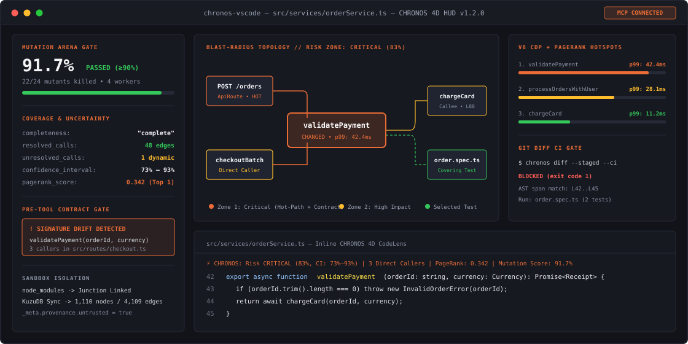

<p align="center">
  
</p>

<h1 align="center">CHRONOS-AGENT</h1>

<p align="center">
  <strong>4D Living Code Graph, Polyglot Cypher Engine, PageRank Blast-Radius &amp; Isolated Mutation Gating for AI Coding Agents</strong>
</p>

<p align="center">
  <a href="https://github.com/ptai-eng/chronos-agent/releases/tag/v1.3.0"></a>
  <a href="https://marketplace.visualstudio.com/items?itemName=ptai-eng.chronos-agent"></a>
  <a href="https://www.rust-lang.org"></a>
  <a href="https://spec.modelcontextprotocol.io"></a>
  <a href="./integrations/INTEGRATIONS.md"></a>
  <a href="#-security--privacy-notice-nvidia-skillspector-alert"></a>
</p>

---

## Table of Contents

- [What's New in v1.3.0](#whats-new-in-v130)
- [Why CHRONOS Exists](#why-chronos-exists)
- [Core Architecture: The 4 Pillars](#core-architecture-the-4-pillars)
- [Capability Matrix &amp; Benchmark](#capability-matrix--benchmark)
- [Developer HUD &amp; VS Code Extension](#developer-hud--vs-code-extension)
- [Universal AI Integrations (9 Clients)](#universal-ai-integrations-9-clients)
- [Quickstart &amp; Installation](#quickstart--installation)
- [CLI Command Suite](#cli-command-suite)
- [Security &amp; Privacy Notice (NVIDIA SkillSpector Alert)](#security--privacy-notice-nvidia-skillspector-alert)

---

## What's New in v1.3.0

`v1.3.0` unifies static graph discovery (`codebase-memory` style Cypher, BM25 search, and community clustering) with CHRONOS's 4D runtime telemetry, PageRank uncertainty bounds, and isolated mutation gating:

| Subsystem | v1.3.0 Upgrade |
| :--- | :--- |
| **Polyglot Tree-Sitter Engine (7 Languages)** | Expanded `LanguageDispatcher` from 3 to **7 language families**: **TypeScript/JS**, **Python**, **Rust**, **Go**, **C**, **C++**, and **Java** with unified `CALLS`, `TESTS`, `CONTAINS`, and `IMPORTS` edge extraction. |
| **Hidden $O(N^2)$ &amp; Loop Complexity Signals** | Every function node computes `loop_count`, `loop_depth`, interprocedural `transitive_loop_depth` (propagated across `CALLS` edges), `linear_scan_in_loop` (`.find`/`.contains`/`.indexOf`/`in ` inside loops), `alloc_in_loop`, and direct/mutual `is_recursive`. |
| **Read-Only Cypher Engine (`chronos_query_graph`)** | Exposes arbitrary read-only OpenCypher queries (`MATCH`, `WHERE`, `RETURN`, `ORDER BY`, `COUNT`) directly over embedded `KuzuDB`, guarded by `validate_readonly_cypher()` to block mutating or file-I/O statements. |
| **BM25 Search &amp; Verbatim Snippets (`chronos_search_graph`, `chronos_get_snippet`)** | Sub-millisecond BM25 search with `camelCase`/`snake_case` identifier tokenization, regex filters, degree/loop-depth thresholds, and exact `start_line..=end_line` source code extraction enriched with callers, callees, and covering tests. |
| **Community Architecture Clustering (`chronos_get_architecture`)** | Deterministic Label Propagation community detection over `Petgraph`, reporting per-cluster Cohesion/Coupling ratios, language breakdown, entry points, top PageRank hubs, and hidden $O(N^2)$ hotspot candidates. |
| **9 Standardized MCP Tools** | Expanded from 5 to **9 MCP tools** (`chronos_analyze_file`, `chronos_get_blast_radius`, `chronos_run_mutation_gate`, `chronos_query_hotspots`, `chronos_contract_status`, `chronos_query_graph`, `chronos_search_graph`, `chronos_get_snippet`, `chronos_get_architecture`), all enforcing `_meta.provenance.untrusted_content = true`. |

---

## Why CHRONOS Exists

AI coding agents read source files as flat text buffers. When an agent edits a utility function in `Module A`, it cannot see whether that function sits on a high-PageRank call path, triggers a transitive $O(N^2)$ nested loop across module boundaries, lacks semantic assertions in its test suite, or runs inside a hot CPU loop in production.

**CHRONOS-AGENT** gives autonomous coding agents a unified structural, queryable, and runtime verification harness:

1. **Polyglot Structural Topology + Cypher:** Builds a 7-language AST graph (`Petgraph` in-memory + `KuzuDB` on disk) queryable via OpenCypher, BM25 identifier search, and Label Propagation community clustering.
2. **Runtime Telemetry Overlay:** Maps Chrome DevTools Protocol (CDP V8) CPU/memory profiles and Linux/WSL2 eBPF tracepoints directly onto AST function nodes.
3. **Graph-Guided Mutation Arena:** Instead of running an entire test suite for 20 minutes, CHRONOS queries `TESTS` edges to execute only the specific tests covering the modified symbol inside isolated parallel sandboxes.
4. **Explicit Epistemic Contracts:** Every blast-radius report discloses its observation coverage (`complete` vs. `partial`), uncertainty interval (`confidence_interval`), and unresolved dynamic call sites (`residual_unknowns`)—never conflating unobserved edges with zero risk.

---

## Core Architecture: The 4 Pillars

<p align="center">
  
</p>

| Pillar | Responsibility | Implementation | Crate Path |
| :--- | :--- | :--- | :--- |
| **1. 4D Knowledge Graph &amp; Cypher** | 7-language AST topology, OpenCypher query engine, BM25 search, community clustering, and live telemetry state | Tree-sitter (`TS`/`JS`/`Py`/`Rs`/`Go`/`C`/`C++`/`Java`) &bull; `Petgraph` (`<15ms` traversal) &bull; Embedded `KuzuDB` Cypher engine | `chronos-core/src/graph/` |
| **2. Mutation Arena** | Semantic test verification before code acceptance | 5 deterministic operators (`ConditionFlip`, `ReturnNull`, `HttpStatusSwap`, `OffByOne`, `BoundaryCondition`) &bull; Parallel temp-dir sandboxes with zero-copy `node_modules`/`.venv` junctions | `chronos-core/src/mutation/` |
| **3. Semantic Contract Broker** | Real-time public signature lock across concurrent agents | 300ms debounced `notify` file watcher &bull; Signature fingerprinting &bull; Breaking-change interception before commit | `chronos-core/src/contract/` |
| **4. Blast-Radius Engine** | Risk scoring with uncertainty bounds | 3-tier classification (`LOW` / `MEDIUM` / `HIGH`) &bull; `CoverageReport` &amp; `confidence_interval` &bull; Markdown glance &amp; HTML visualizer | `chronos-core/src/blast_radius/` |

---

## Capability Matrix &amp; Benchmark

<p align="center">
  
</p>

### Comparison Across Tool Classes

| Capability | Static Linters (`ESLint`, `SonarQube`) | Vanilla Coding Agents (`Copilot`, `Cursor` alone) | Static Graph MCPs (`GitNexus`, `codebase-memory`) | **CHRONOS-AGENT v1.3** |
| :--- | :---: | :---: | :---: | :---: |
| **Polyglot Call &amp; Test Graph** | Single-file rules | Token window only | Static AST edges | **7 Languages + Macro `token_tree` + PageRank** |
| **Cypher &amp; BM25 Code Discovery** | No | Grep / Glob only | Read-only Cypher + BM25 | **Read-Only KuzuDB Cypher + BM25 + Snippet Context** |
| **Hidden $O(N^2)$ Loop Detection** | Basic lint rules | No | Intra-function only | **Interprocedural `transitive_loop_depth` + `linear_scan_in_loop`** |
| **Runtime Telemetry** | No | No | No | **CDP V8 Profiler + Linux eBPF** |
| **Mutation Testing Gate** | No | No | No | **Graph-Guided Parallel Sandboxes (`<1.5s`)** |
| **Uncertainty &amp; Coverage Bounds** | No | No | Unobserved = 0 callers | **`confidence_interval` + `residual_unknowns`** |
| **Pre-Tool Contract Broker** | No | No | No | **Live Signature Diff Interceptor** |

---

## Developer HUD &amp; VS Code Extension

<p align="center">
  
</p>

> [!TIP]
> **Available on Visual Studio Marketplace:**  
> Search **"CHRONOS Agent"** in the VS Code Extensions view (`Ctrl+Shift+X`), or install from the [VS Code Marketplace Listing](https://marketplace.visualstudio.com/items?itemName=ptai-eng.chronos-agent).

The companion extension (`chronos-vscode/`) integrates the `chronos-mcp` engine into your editor:

- **Continuous Polyglot Watcher:** Automatically re-indexes modified `.ts`, `.tsx`, `.js`, `.py`, `.rs`, `.go`, `.c`, `.cpp`, and `.java` files on save, rebuilding cross-file call edges, updating `ContractBroker` signatures, and syncing changes to `KuzuDB`.
- **Blast-Radius &amp; Uncertainty HUD:** Displays each function's composite risk score, $[low, high]$ confidence interval, PageRank centrality, transitive loop depth, and surviving mutants right inside VS Code.
- **Zero-Config Binary Discovery:** Connects to your workspace binary or downloads pre-compiled platform releases automatically.

---

## Universal AI Integrations (9 Clients)

`chronos-mcp` speaks standard **Model Context Protocol (MCP v2024-11-05)** over stdio JSON-RPC 2.0 and exposes **9 specialized tools**:

1. `chronos_analyze_file` — Parse source file (7 language families), extract AST symbols/edges, and persist to KuzuDB.
2. `chronos_get_blast_radius` — Compute PageRank blast-radius, risk score, `confidence_interval`, and `residual_unknowns`.
3. `chronos_run_mutation_gate` — Run isolated parallel mutation testing on covering tests before accepting edits.
4. `chronos_query_hotspots` — Identify runtime telemetry bottlenecks, PageRank hubs, and high-complexity functions.
5. `chronos_contract_status` — Verify public signature locks and breaking changes across concurrent agent sessions.
6. `chronos_query_graph` — Execute read-only OpenCypher queries (`MATCH (n:ChronosNode) ...`) over KuzuDB.
7. `chronos_search_graph` — Search symbols via BM25 identifier tokenization (`camelCase`/`snake_case`), regex, and loop/degree filters.
8. `chronos_get_snippet` — Read exact `start_line..=end_line` source code with callers, callees, covering tests, and loop metrics.
9. `chronos_get_architecture` — Discover architectural communities (Label Propagation), cohesion ratios, and hidden $O(N^2)$ hotspots.

| Client | Platform | Configuration Path |
| :--- | :--- | :--- |
| **Antigravity (Google)** | CLI / IDE | `~/.gemini/antigravity/mcp/` |
| **Cursor** | IDE | `.cursor/mcp.json` |
| **Claude Desktop** | Desktop | `%APPDATA%\Claude\claude_desktop_config.json` |
| **Windsurf** | IDE | `.windsurf/mcp.json` |
| **Cline** | VS Code Extension | `settings.json` |
| **OpenAI Codex CLI** | CLI | `~/.codex/config.json` |
| **OpenCode** | CLI | `.opencode.toml` |
| **Continue** | VS Code / JetBrains | `.continue/config.json` |
| **Zed** | Editor | `~/.config/zed/settings.json` |

Generate ready-to-paste configuration snippets for any client:

```bash
chronos mcp --client all
```

---

## Quickstart &amp; Installation

### Option 1: Pre-Compiled Binaries

Download the latest release archive from [GitHub Releases](https://github.com/ptai-eng/chronos-agent/releases):
- **Windows (x64):** `chronos-windows-x64.zip` (`chronos.exe` + `chronos-mcp.exe`)
- **Linux (x64):** `chronos-linux-x64.tar.gz`
- **macOS (Apple Silicon):** `chronos-macos-arm64.tar.gz`
- **VS Code Extension:** `chronos-agent-1.3.0.vsix`

### Option 2: Build from Source

```powershell
# Prerequisites: Rust 1.85+ (2024 Edition), CMake / MSVC Build Tools (for KuzuDB C++ FFI)
git clone https://github.com/ptai-eng/chronos-agent.git
cd chronos-agent
cargo build --release

# Compiled binaries:
# ./target/release/chronos-mcp.exe  (MCP Server)
# ./target/release/chronos.exe      (CLI Harness)
```

---

## CLI Command Suite

```powershell
# 1. Full 4-Pillar Audit (AST + Blast Radius + Contract Check + Mutation Gate)
#    Supports .ts, .tsx, .js, .py, .rs, .go, .c, .cpp, .java
chronos audit src/services/orderService.ts
chronos audit chronos-core/src/graph/schema.rs

# 2. Architectural Community Discovery & Hidden O(N^2) Hotspot Detection (v1.3)
chronos arch
chronos arch chronos-core/src

# 3. BM25 Identifier Search & Regex Discovery (v1.3)
chronos search --query "blast radius" --limit 5
chronos search --pattern ".*Parser.*" --min-loop-depth 2

# 4. Verbatim Function Snippet + Callers/Callees/Tests Context (v1.3)
chronos snippet handle_blast_radius

# 5. Read-Only OpenCypher Query against KuzuDB (v1.3)
chronos query "MATCH (n:ChronosNode) WHERE n.transitive_loop_depth >= 2 RETURN n.name, n.loop_depth, n.transitive_loop_depth, n.linear_scan_in_loop LIMIT 10"

# 6. 30-Second Executive Glance (includes confidence interval & coverage report)
chronos glance src/services/orderService.ts --symbol processOrdersWithUserInfo

# 7. Monitor Real-Time Contract Broker Signatures
chronos status --watch src/services/

# 8. Git Diff Blast-Radius & CI Gate (full AST span matching + ImpactAnalyzer)
chronos diff                          # Unstaged working tree changes
chronos diff --staged --json --ci     # Machine-readable JSON; exits 1 on HIGH risk
```

---

## Security &amp; Privacy Notice (NVIDIA SkillSpector Alert)

> [!WARNING]
> **Why static heuristic scanners (such as NVIDIA SkillSpector) flag this repository:**
> 
> `CHRONOS-AGENT` is a system-level code intelligence and runtime profiling harness. Because it intentionally interfaces with privileged debugging and kernel telemetry APIs, static keyword scanners report false-positive risk alerts:
>
> 1. **eBPF Kernel Tracepoints (`chronos-core/src/telemetry/ebpf_adapter.rs`):** Attaches Linux kernel/uprobe tracepoints for low-overhead latency profiling.
> 2. **Chrome DevTools Protocol (`chronos-core/src/telemetry/cdp_client.rs`):** Connects to local V8 inspector WebSockets to sample live CPU and heap allocations.
> 3. **Subprocess Mutation Runner (`chronos-core/src/mutation/runner.rs`):** Spawns isolated test-runner subprocesses inside temporary sandboxes with timeout watchdogs.
> 4. **MCP Client Config Generator (`chronos-cli/src/commands/mcp_config.rs`):** Emits configuration templates for `.cursor/`, `.claude/`, and `.gemini/` directories.
>
> Every MCP tool enforces canonical workspace path validation (`validate_path_within_workspace`), read-only Cypher guards (`validate_readonly_cypher`), parameterized KuzuDB writes, and `_meta.provenance.untrusted_content` tagging.

---

## License

Distributed under the **MIT License**. See `LICENSE` for details.
